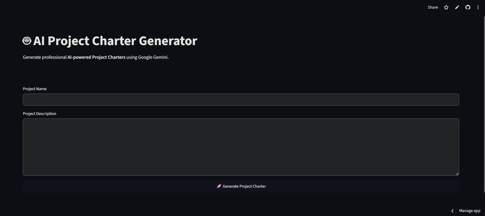

# 🤖 AI Project Charter Generator

Generate professional AI-powered Project Charters in seconds using **Google Gemini AI** and **Streamlit**.

This application helps project managers, business analysts, startup teams, and students quickly generate structured Project Charters from a project name and description.

---

## 🌐 Live Demo

**Application:** https://ai-project-charter-generator.streamlit.app

> ⚠️ **Important:** This application is hosted on Streamlit Community Cloud. If the app has gone to sleep due to inactivity, you may see a wake-up screen. Simply click **"Yes, get this app back up!"** and wait about **30–60 seconds**. Once the app wakes up, it will open and function normally.

---

## 📸 Application Preview



---

## ✨ Features

- 🤖 AI-powered Project Charter generation using Google Gemini
- 📋 Professional PMBOK-inspired Project Charter structure
- 📄 Export generated charter as PDF
- ⚡ Clean and responsive Streamlit interface
- 🔒 Secure API key management using Streamlit Secrets
- ☁️ Cloud deployment with Streamlit Community Cloud

---

## 📌 Generated Project Charter Includes

- Project Overview
- Business Need
- Project Objectives
- Project Scope
  - In Scope
  - Out of Scope
- Key Stakeholders
- Major Deliverables
- Estimated Timeline
- Assumptions & Constraints
- Estimated Budget (ROM)
- Key Risks
- Project Manager Authority
- Success Criteria
- Sponsor Approval

---

## 🛠️ Tech Stack

| Category | Tools |
|---|---|
| Programming Language | Python |
| Framework | Streamlit |
| Artificial Intelligence | Google Gemini API |
| File Generation | ReportLab (PDF export) |
| Environment Management | python-dotenv |

---

## 📁 Project Structure

```text
AI-Project-Charter-Generator/
│
├── app.py
├── requirements.txt
├── README.md
├── app-home.png
├── .gitignore
└── .env (local only)
```

---

## ⚙️ Installation

### 1. Clone the repository
```bash
git clone https://github.com/gopichand-7/AI-Project-Charter-Generator.git
```

### 2. Move into the project directory
```bash
cd AI-Project-Charter-Generator
```

### 3. Create a virtual environment
```bash
python -m venv venv
```

### 4. Activate the environment

**Windows**
```bash
venv\Scripts\activate
```

**macOS / Linux**
```bash
source venv/bin/activate
```

### 5. Install the required packages
```bash
pip install -r requirements.txt
```

---

## 🔑 Environment Variables

Create a `.env` file in the project root:
```env
GEMINI_API_KEY=YOUR_GEMINI_API_KEY
```

For Streamlit deployment, add the following to **Streamlit Secrets**:
```toml
GEMINI_API_KEY = "YOUR_GEMINI_API_KEY"
```

> ⚠️ Never commit your Gemini API key or `.env` file to GitHub.

---

## ▶️ Run the Application

```bash
streamlit run app.py
```

The app will be available at `http://localhost:8501`.

---

## 💼 Use Cases

- Project Managers
- Business Analysts
- Product Managers
- Startup Teams
- Students
- PMO Teams
- Freelancers

---

## 🧪 Sample Inputs

You can use the following examples to quickly test the application.

### Example 1 — E-Commerce Website Development

**Project Title**
```
E-Commerce Website Development
```

**Project Description**
```
Develop a responsive e-commerce platform that allows customers to browse products, place orders, make secure online payments, and track deliveries.
```

---

### Example 2 — Hospital Management System

**Project Title**
```
Hospital Management System
```

**Project Description**
```
Build a centralized hospital management system to manage patient records, appointments, billing, pharmacy, and staff operations.
```

---

### Example 3 — University Library Management System

**Project Title**
```
University Library Management System
```

**Project Description**
```
Develop a digital library system that enables students to search, borrow, reserve, and return books while allowing librarians to manage inventory efficiently.
```

---

### Example 4 — Employee Attendance Tracking System

**Project Title**
```
Employee Attendance Tracking System
```

**Project Description**
```
Create a web-based attendance system that records employee check-in and check-out times, generates attendance reports, and integrates leave management.
```

---

## 🚀 Future Improvements

- DOCX Export
- Editable Generated Content
- Multiple Charter Templates
- Organization Branding
- Risk Matrix
- Timeline Visualization

---

## 👨‍💻 Author

**Gopichand Kollapattu**
GitHub: [github.com/gopichand-7](https://github.com/gopichand-7)

---

## 📄 License

This project is licensed under the **[MIT License](LICENSE)**.
